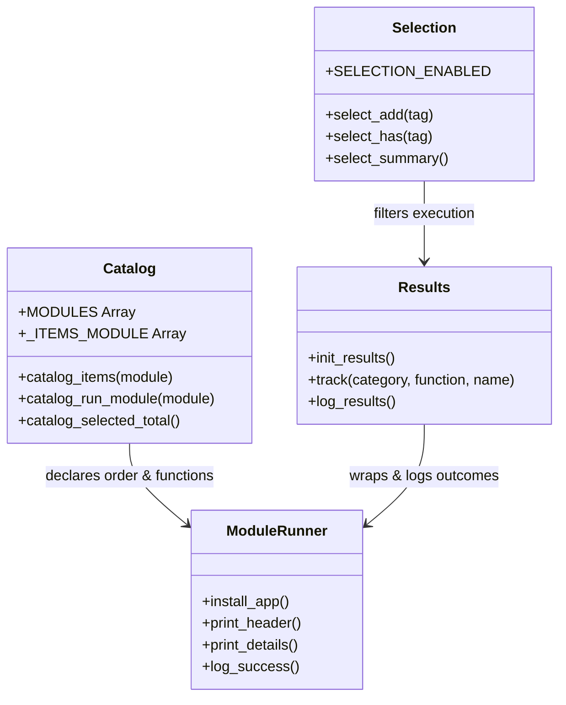

# Ubuntu Initial Setup

<p align="center">
  <a href="README.pt-BR.md">🇧🇷 Versão em Português</a>
</p>

<p align="center">
  <a href="https://github.com/angelorpt/ubuntu-initial-setup/blob/main/LICENSE"></a>
  
  
  
</p>

<p align="center">
  
</p>

---

Modular, resilient, and interactive shell suite designed to automate workstation setup on Ubuntu systems and development environments. Tailored for engineers who want quick setups from scratch, fresh reinstalls, or automated headless configurations.

---

## Table of Contents

- [Features](#features)
- [Quick Start](#quick-start)
  - [1. Bootstrap (Recommended)](#1-bootstrap-recommended)
  - [2. Manual Execution](#2-manual-execution)
  - [Bootstrap vs. Direct Runner](#bootstrap-vs-direct-runner)
- [Command Flags](#command-flags)
- [Interactive Workflow](#interactive-workflow)
- [Modules & Software Catalog](#modules--software-catalog)
  - [Base](#base)
  - [Dev](#dev)
  - [AI](#ai)
  - [Tools Terminal](#tools-terminal)
  - [Tools Desktop](#tools-desktop)
  - [Tools Ubuntu](#tools-ubuntu)
  - [Media](#media)
  - [Fonts](#fonts)
  - [Config](#config)
  - [NPM Globals](#npm-globals)
- [Architecture & Design](#architecture--design)
- [Testing & Quality](#testing--quality)
- [Directory Structure](#directory-structure)
- [Extending the Catalog](#extending-the-catalog)
- [License](#license)

---

## Features

- **Whiptail TUI & Headless Options**: Interactive step-by-step terminal UI or single-command unattended execution (`--all --yes`).
- **Resilient Execution (`set -uo pipefail`)**: Tool failures are logged and tracked without aborting the remaining installation pipeline.
- **Granular Selection**: Pick entire categories or drill down to select individual packages.
- **State Tracking & Retry**: Execution outcomes are saved in `results/`, enabling `--retry` (re-run failed items only) and `--continue` (skip installed tools).
- **Single Source of Truth**: All modules, names, and install orders derive from a centralized catalog (`lib/catalog.sh`).
- **Automated Testing**: Comprehensive ShellCheck linting and BATS unit tests for every library helper.

---

## Quick Start

### 1. Bootstrap (Recommended)

One-line runner that installs prerequisites (`git`, `curl`, `wget`, `whiptail`), clones the repository to `~/ubuntu-initial-setup`, and launches the interactive menu:

```bash
curl -fsSL https://raw.githubusercontent.com/angelorpt/ubuntu-initial-setup/main/bootstrap.sh | bash
```

**Unattended / Headless (CI or automated scripts):**
```bash
curl -fsSL https://raw.githubusercontent.com/angelorpt/ubuntu-initial-setup/main/bootstrap.sh | bash -s -- --all --yes
```

**Rerun at any time:**
```bash
cd ~/ubuntu-initial-setup
./install.sh
```

---

### 2. Manual Execution

Clone and run directly with standard or tailored flags:

```bash
# Clone
git clone https://github.com/angelorpt/ubuntu-initial-setup.git
cd ubuntu-initial-setup

# Interactive Whiptail Menu (Environment -> Mode -> Categories -> Items -> Confirm)
./install.sh

# Run specifically with Headless / WSL profile (CLI only)
./install.sh --headless

# Install Everything (requests final confirmation)
./install.sh --all

# Fully Unattended Install (no confirmations)
./install.sh --all --yes

# Reinstall / Update all tools
./install.sh --update

# Retry only previously failed packages
./install.sh --retry

# Continue interrupted installation (skips successful ones)
./install.sh --continue
```

---

### Bootstrap vs. Direct Runner

| Feature | `bootstrap.sh` | `install.sh` |
| :--- | :--- | :--- |
| **Purpose** | Single-line quick setup for new or fresh systems | Direct fine-grained control and management |
| **Cloning** | Automatic (into `~/ubuntu-initial-setup`) | Manual (`git clone`) |
| **Prerequisites** | Installs `git`, `curl`, `wget`, `whiptail` automatically | Assumes standard dependencies exist |
| **Interactive TUI** | Yes (via `/dev/tty`) | Yes (default when run without flags) |
| **Headless Support** | Pass args via `bash -s -- --all --yes` | Pass flags directly: `./install.sh --all --yes` |
| **Recovery** | Supports `--retry` and `--continue` through arguments | Native flags: `--retry`, `--continue` |

---

## Command Flags

| Flag | Description |
| :--- | :--- |
| `--all` | Preselects all modules and items; displays confirmation before running |
| `--headless`, `--wsl` | Activates Headless/WSL profile (omits GUI packages & desktop modules) |
| `--desktop` | Activates Standard Ubuntu Desktop profile |
| `--profile=TYPE` | Sets environment profile: `desktop` or `headless` (or `wsl`) |
| `--all --yes` | Fully headless; selects all items and installs without prompts |
| `--update` | Fresh reinstall of all tools, fetching latest versions |
| `--retry` | Reads `results/failure.txt` and runs only tools that failed |
| `--continue` | Reads `results/success.txt` and installs only remaining pending items |
| `--yes`, `-y` | Bypasses confirmation prompt (must be paired with target selection) |
| `--help`, `-h` | Displays usage manual and flags |

---

## Interactive Workflow

```mermaid
flowchart TD
    Start([Execute ./install.sh]) --> CheckTTY{Interactive TTY?}
    CheckTTY -- No without --yes --> Error[Exit with Error]
    CheckTTY -- Yes --> EnvSelect[Environment: Desktop vs. Headless/WSL]
    
    EnvSelect --> ModeSelect[Mode: New / Continue / Retry]
    ModeSelect --> CatMenu[Select Categories Checklist - Defaults to OFF]
    CatMenu --> CategoryBatch{Category Action}
    CategoryBatch -- All --> SelectAllCat[Select All in Category]
    CategoryBatch -- Custom --> ItemMenu[Select Individual Items - Defaults to OFF]
    CategoryBatch -- Skip --> SkipCat[Skip Category]
    
    SelectAllCat --> Summary[Display Selection Summary]
    ItemMenu --> Summary
    SkipCat --> Summary
    Summary --> Confirm{Confirm Installation?}
    
    Confirm -- Cancel --> Cancelled[Exit]
    Confirm -- Yes --> RunModules[Execute Modules in Catalog Order]
    
    RunModules --> Track[track & log results]
    Track --> Results[Write to results/success.txt & failure.txt]
    Results --> End([Print Final Report])
```

---

## Modules & Software Catalog

The suite contains **10 modules** providing **91 curated tools**. All metadata is declared in [`lib/catalog.sh`](lib/catalog.sh).

| Module | Items | Summary |
| :--- | :---: | :--- |
| [`base`](#base) | 4 | Essential CLI foundations (curl, git, gum, zsh + oh-my-zsh) |
| [`dev`](#dev) | 23 | Compilers, runtimes, containers, cloud & k8s tooling |
| [`ai`](#ai) | 6 | Local LLM runtimes and AI engineering terminal assistants |
| [`tools_terminal`](#tools-terminal) | 15 | Modern CLI utilities, multiplexers, and file viewers |
| [`tools_desktop`](#tools-desktop) | 12 | Productivity, screen capture, GUI DB managers & system tools |
| [`tools_ubuntu`](#tools-ubuntu) | 8 | System maintenance, package managers, and security |
| [`media`](#media) | 2 | Web browsers |
| [`fonts`](#fonts) | 6 | Developer monospace fonts with programming ligatures |
| [`config`](#config) | 3 | Git identity, SSH key generation, and terminal color schemes |
| [`npm_globals`](#npm-globals) | 12 | Global Node CLI packages and package managers |

---

### Base

| Tool | Description | Website |
| :--- | :--- | :--- |
| **Curl** | Command line tool for transferring data with URLs | [curl.se](https://curl.se) |
| **Git** | Distributed version control system | [git-scm.com](https://git-scm.com) |
| **Gum** | Tool for glamorous shell scripts and prompts | [github.com/charmbracelet/gum](https://github.com/charmbracelet/gum) |
| **Zsh + Oh My Zsh** | Extended shell with plugins and themes | [ohmyz.sh](https://ohmyz.sh) |

### Dev

| Tool | Description | Website |
| :--- | :--- | :--- |
| **build-essential** | Meta-package with gcc, g++, make, and build toolchain | [packages.ubuntu.com](https://packages.ubuntu.com/build-essential) |
| **libssl-dev** | OpenSSL development headers | [packages.ubuntu.com](https://packages.ubuntu.com/libssl-dev) |
| **Python** | Python 3 and pip runtime | [python.org](https://www.python.org) |
| **Docker** | Container platform (Engine + Compose) | [docs.docker.com](https://docs.docker.com/engine/install/ubuntu) |
| **NVM + Node** | Node Version Manager with current Node LTS | [github.com/nvm-sh/nvm](https://github.com/nvm-sh/nvm) |
| **Java (JDK)** | OpenJDK Java Development Kit | [openjdk.org](https://openjdk.org) |
| **VSCode** | Visual Studio Code editor | [code.visualstudio.com](https://code.visualstudio.com) |
| **Go** | Go programming language | [snapcraft.io/go](https://snapcraft.io/go) |
| **Postman** | API development platform | [snapcraft.io/postman](https://snapcraft.io/postman) |
| **VirtualBox** | Open-source hypervisor | [virtualbox.org](https://www.virtualbox.org) |
| **Antigravity 2.0** | Agent-first developer platform | [antigravity.google](https://antigravity.google) |
| **Antigravity IDE** | Agent-first IDE | [antigravity.google](https://antigravity.google) |
| **Terraform** | Infrastructure as Code | [developer.hashicorp.com](https://developer.hashicorp.com/terraform/install#linux) |
| **Vagrant** | Reproducible development environments | [developer.hashicorp.com](https://developer.hashicorp.com/vagrant/install) |
| **GitHub CLI** | Official GitHub command line tool | [cli.github.com](https://cli.github.com) |
| **AWS CLI** | Official Amazon Web Services CLI | [aws.amazon.com/cli](https://aws.amazon.com/cli) |
| **Ansible** | IT automation platform | [ansible.com](https://www.ansible.com) |
| **kubectl** | Kubernetes CLI tool | [kubernetes.io](https://kubernetes.io) |
| **Helm** | Kubernetes package manager | [helm.sh](https://helm.sh) |
| **Minikube** | Local single-node Kubernetes cluster | [minikube.sigs.k8s.io](https://minikube.sigs.k8s.io) |
| **Kiro CLI** | Official CLI for the Kiro platform | [kiro.dev/cli](https://kiro.dev/cli) |
| **ShellCheck** | Static analysis linter for shell scripts | [shellcheck.net](https://www.shellcheck.net) |
| **BATS** | Automated Bash Automated Testing System | [bats-core.readthedocs.io](https://bats-core.readthedocs.io) |

### AI

| Tool | Description | Website |
| :--- | :--- | :--- |
| **Ollama** | Local LLM runner and management | [ollama.com](https://ollama.com) |
| **OpenCode** | Terminal AI software engineering assistant | [opencode.ai](https://opencode.ai) |
| **Serena** | Semantic MCP toolkit for code agents | [github.com/oraios/serena](https://github.com/oraios/serena) |
| **Antigravity CLI** | Google agent-first command line interface | [antigravity.google](https://antigravity.google) |
| **Claude Code** | Anthropic terminal coding agent | [code.claude.com](https://code.claude.com) |
| **GitHub Copilot CLI** | GitHub AI assistant for command-line terminals | [github.com/features/copilot/cli](https://github.com/features/copilot/cli) |

### Tools Terminal

| Tool | Description | Website |
| :--- | :--- | :--- |
| **htop** | Interactive process viewer | [htop.dev](https://htop.dev) |
| **tmux** | Terminal multiplexer with persistent sessions | [github.com/tmux/tmux](https://github.com/tmux/tmux) |
| **ripgrep** | Blazing-fast regex recursive search | [github.com/BurntSushi/ripgrep](https://github.com/BurntSushi/ripgrep) |
| **fd** | Simple, fast, and user-friendly alternative to find | [github.com/sharkdp/fd](https://github.com/sharkdp/fd) |
| **fzf** | Command-line fuzzy finder | [github.com/junegunn/fzf](https://github.com/junegunn/fzf) |
| **bat** | Cat clone with syntax highlighting and Git integration | [github.com/sharkdp/bat](https://github.com/sharkdp/bat) |
| **eza** | Modern replacement for ls with icons and git status | [github.com/eza-community/eza](https://github.com/eza-community/eza) |
| **Starship** | Fast, customizable cross-shell prompt | [starship.rs](https://starship.rs) |
| **zoxide** | Smarter cd command that learns your habits | [github.com/ajeetdsouza/zoxide](https://github.com/ajeetdsouza/zoxide) |
| **Nano** | Easy-to-use terminal text editor | [nano-editor.org](https://www.nano-editor.org) |
| **Vim** | Highly configurable text editor | [vim.org](https://www.vim.org) |
| **Neovim** | Hyperextensible Vim-based text editor with Lua | [neovim.io](https://neovim.io) |
| **Anyquery** | Query any data source using SQL | [anyquery.dev](https://anyquery.dev) |
| **Superfile** | Modern terminal file manager | [superfile.dev](https://superfile.dev) |
| **fdupes** | Duplicate file finder and manager | [github.com/adrianlopezroche/fdupes](https://github.com/adrianlopezroche/fdupes) |

### Tools Desktop

| Tool | Description | Website |
| :--- | :--- | :--- |
| **Flameshot** | Powerful screenshot tool with in-app annotations | [flameshot.org](https://flameshot.org) |
| **Espanso** | Cross-platform text expander | [espanso.org](https://espanso.org) |
| **HyperKeys** | Global custom keyboard shortcut manager | [hyperkeys.xureilab.com](https://hyperkeys.xureilab.com) |
| **IMWheel** | Mouse wheel scroll speed modifier | [imwheel.sourceforge.net](https://imwheel.sourceforge.net) |
| **GParted** | Partition editor for disk management | [gparted.org](https://gparted.org) |
| **Wave Terminal** | Modern terminal with inline UI rendering | [waveterm.dev](https://www.waveterm.dev) |
| **Warp Terminal** | Rust-based modern terminal with AI integration | [warp.dev](https://www.warp.dev) |
| **Draw.io** | Diagramming and flowchart tool | [drawio.com](https://www.drawio.com) |
| **DBeaver** | Universal multi-platform database manager | [dbeaver.io](https://dbeaver.io) |
| **Stacer** | Linux system optimizer and hardware monitor | [github.com/oguzhaninan/Stacer](https://github.com/oguzhaninan/Stacer) |
| **BleachBit** | Disk space cleaner and cache privacy manager | [bleachbit.org](https://www.bleachbit.org) |
| **Timeshift** | System restore tool with incremental snapshots | [github.com/linuxmint/timeshift](https://github.com/linuxmint/timeshift) |

### Tools Ubuntu

| Tool | Description | Website |
| :--- | :--- | :--- |
| **Nala** | Elegant, parallel frontend for apt | [github.com/volitank/nala](https://github.com/volitank/nala) |
| **neofetch** | CLI system information tool | [github.com/dylanaraps/neofetch](https://github.com/dylanaraps/neofetch) |
| **ncdu** | NCurses disk usage analyzer | [dev.yorhel.nl/ncdu](https://dev.yorhel.nl/ncdu) |
| **duf** | Better disk usage utility with tables and colors | [github.com/muesli/duf](https://github.com/muesli/duf) |
| **deborphan** | Finds orphaned packages on Debian/Ubuntu | [packages.ubuntu.com](https://packages.ubuntu.com/deborphan) |
| **lm-sensors** | Hardware temperature and fan sensor reader | [github.com/lm-sensors/lm-sensors](https://github.com/lm-sensors/lm-sensors) |
| **UFW** | Uncomplicated Firewall manager | [launchpad.net/ufw](https://launchpad.net/ufw) |
| **Unattended Upgrades** | Automatic security updates setup | [wiki.debian.org](https://wiki.debian.org/UnattendedUpgrades) |

### Media

| Tool | Description | Website |
| :--- | :--- | :--- |
| **Google Chrome** | Modern web browser by Google | [google.com/chrome](https://www.google.com/chrome) |
| **Brave** | Privacy-focused secure web browser | [brave.com](https://brave.com) |

### Fonts

| Tool | Description | Website |
| :--- | :--- | :--- |
| **Fira Code** | Monospace font with programming ligatures | [github.com/tonsky/FiraCode](https://github.com/tonsky/FiraCode) |
| **JetBrains Mono** | Developer typeface created by JetBrains | [jetbrains.com/lp/mono](https://www.jetbrains.com/lp/mono) |
| **Cascadia Code** | Monospaced font created by Microsoft | [github.com/microsoft/cascadia-code](https://github.com/microsoft/cascadia-code) |
| **IBM Plex** | Open-source typeface superfamily by IBM | [github.com/IBM/plex](https://github.com/IBM/plex) |
| **Victor Mono** | Slanted monospaced font with cursive italics | [rubjo.github.io/victor-mono](https://rubjo.github.io/victor-mono) |
| **Monaspace** | GitHub typography system for coding | [monaspace.githubnext.com](https://monaspace.githubnext.com) |

### Config

| Step | Description |
| :--- | :--- |
| **Git Config** | Interactive prompt to configure global git name and email |
| **SSH Key** | Generation of ED25519 SSH keys for GitHub/GitLab authentication |
| **Gogh Terminal** | Over 200 color schemes for GNOME and Linux terminals |

### NPM Globals

| Package | Description | Website |
| :--- | :--- | :--- |
| **TypeScript** | Typed JavaScript language compiler | [typescriptlang.org](https://www.typescriptlang.org) |
| **pnpm** | Fast, disk space efficient package manager | [pnpm.io](https://pnpm.io) |
| **Yarn Classic** | Classic Node.js package manager (v1.22.x) | [classic.yarnpkg.com](https://classic.yarnpkg.com) |
| **Yarn Berry** | Modern Yarn (v4.x) via Corepack | [yarnpkg.com](https://yarnpkg.com) |
| **Nodemon** | Automatic script reloader for Node applications | [nodemon.io](https://nodemon.io) |
| **Concurrently** | Run multiple commands concurrently | [github.com/open-cli-tools/concurrently](https://github.com/open-cli-tools/concurrently) |
| **Serve** | Static file serving and single page apps | [github.com/vercel/serve](https://github.com/vercel/serve) |
| **Nest.js** | Progressive Node.js framework CLI | [nestjs.com](https://nestjs.com) |
| **npm-check-updates** | Upgrades package.json dependencies | [github.com/raineorshine/npm-check-updates](https://github.com/raineorshine/npm-check-updates) |
| **live-server** | Development HTTP server with live reloading | [github.com/tapio/live-server](https://github.com/tapio/live-server) |
| **9Router** | Fast command-line routing utility | [github.com/kbrgl/9router](https://github.com/kbrgl/9router) |
| **OpenSpec** | Spec-driven change manager for AI workflows | [openspec.dev](https://openspec.dev) |

---

## Architecture & Design

The project is structured around clear separation of concerns, single source of truth, and strict defensive shell scripting:



### Key Principles

- **SOLID (Shell Adaptation)**:
  - *Single Responsibility*: Every `install_*` function strictly installs one tool. Shared infrastructure resides in `lib/`.
  - *Open/Closed*: Adding tools or modules requires appending to `lib/catalog.sh` without altering installer loops.
  - *Dependency Inversion*: Modules do not couple to Whiptail TUI directly; executions pass through `catalog_run_module` and `track`.
- **DRY (Don't Repeat Yourself)**: Common patterns are encapsulated in `lib/utils.sh` (`install_deb`, `download_to_temp`, `ensure_snap`, `ensure_flatpak`).
- **Safety First**: Directory changes are guarded with `pushd ... || return 1` and `popd`. Inputs use `read -r`.

---

## Testing & Quality

All codebase changes are validated against strict static analysis and unit tests:

```bash
# Run full suite (ShellCheck + BATS)
bash tests/run.sh

# Run static linter only
bash tests/lint.sh

# Run BATS unit tests only
bats tests/lib/
```

Continuous integration runs these tests on every pull request to guarantee zero regressions.

---

## Directory Structure

```text
ubuntu-initial-setup/
├── bootstrap.sh            # Remote curl-pipe-bash bootstrap script
├── install.sh              # Central CLI and Whiptail orchestrator
├── install/                # Installation logic per category
│   ├── _template.sh        # Developer template for creating new modules
│   ├── base.sh             # Essential CLI tooling
│   ├── dev.sh              # Programming runtimes, build tools, Docker, k8s
│   ├── ai.sh               # Local LLMs and agent CLI tools
│   ├── tools_terminal.sh   # Terminal utilities and multiplexers
│   ├── tools_desktop.sh    # Desktop GUI applications
│   ├── tools_ubuntu.sh     # System maintainers and firewall
│   ├── media.sh            # Web browsers
│   ├── fonts.sh            # Monospace programming fonts
│   ├── config.sh           # Git, SSH, and terminal themes
│   └── npm-globals.sh      # Global NPM tools
├── lib/                    # Reusable modular engine
│   ├── catalog.sh          # Single source of truth for items and modules
│   ├── selection.sh        # Selection tags and filter registry
│   ├── results.sh          # Execution logging, report generator, retry state
│   ├── progress.sh         # Dynamic terminal progress bars
│   ├── utils.sh            # System wrappers (install_deb, snap, flatpak)
│   ├── log.sh              # Formatted colored log outputs
│   └── colors.sh           # ANSI color definitions
└── tests/                  # Test suite
    ├── run.sh              # Master test runner
    ├── lint.sh             # ShellCheck runner
    └── lib/                # BATS test specs
```

---

## Extending the Catalog

To add a new tool:

1. **Add function in `install/<module>.sh`**:
   ```bash
   install_mytool() {
     # https://mytool.org
     print_header "MyTool" "Tool description"
     print_details "https://mytool.org" "Feature 1" "Feature 2"
     # commands to install
     log_success "MyTool installed"
   }
   ```
2. **Register in `lib/catalog.sh`**:
   Append `"install_mytool|MyTool|Short description"` to `_ITEMS_<MODULE>`.
3. **Verify**:
   Run `bash tests/run.sh` to confirm linting and tests pass.

---

## License

This project is open-source software licensed under the [MIT License](LICENSE).
