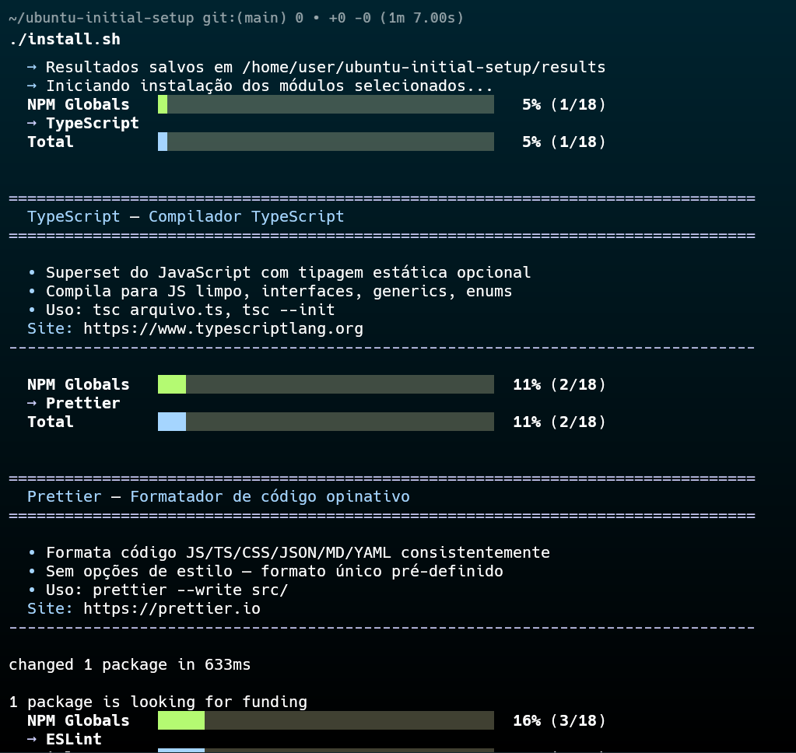
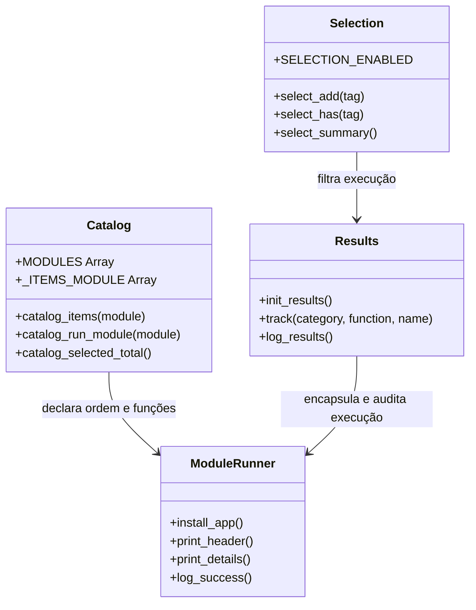

# Ubuntu Initial Setup

<p align="center">
  <a href="README.md">🇺🇸 English Version</a>
</p>

<p align="center">
  <a href="https://github.com/angelorpt/ubuntu-initial-setup/blob/main/LICENSE"></a>
  
  
  
</p>

<p align="center">
  
</p>

---

Suíte modular, resiliente e interativa em Shell Script desenvolvida para automatizar a configuração completa de estações de trabalho e ambientes de desenvolvimento no Ubuntu. Ideal para quem formata o computador com frequência, monta máquinas do zero ou necessita de automação headless.

---

## Sumário

- [Recursos](#recursos)
- [Início Rápido](#início-rápido)
  - [1. Bootstrap (Recomendado)](#1-bootstrap-recomendado)
  - [2. Execução Manual](#2-execução-manual)
  - [Bootstrap vs. Execução Direta](#bootstrap-vs-execução-direta)
- [Flags e Comandos](#flags-e-comandos)
- [Fluxo Interativo](#fluxo-interativo)
- [Módulos e Catálogo de Programas](#módulos-e-catálogo-de-programas)
  - [Base](#base)
  - [Dev](#dev)
  - [AI](#ai)
  - [Tools Terminal](#tools-terminal)
  - [Tools Desktop](#tools-desktop)
  - [Tools Ubuntu](#tools-ubuntu)
  - [Media](#media)
  - [Fonts](#fonts)
  - [Config](#config)
  - [NPM Globals](#npm-globals)
- [Arquitetura e Boas Práticas](#arquitetura-e-boas-práticas)
- [Testes e Qualidade](#testes-e-qualidade)
- [Estrutura de Diretórios](#estrutura-de-diretórios)
- [Como Adicionar Novos Programas](#como-adicionar-novos-programas)
- [Licença](#licença)

---

## Recursos

- **TUI Whiptail e Modo Headless**: Interface gráfica no terminal em etapas ou execução automatizada sem perguntas (`--all --yes`).
- **Execução Resiliente (`set -uo pipefail`)**: Falhas pontuais são registradas sem abortar os demais pacotes da fila.
- **Seleção Granular**: Escolha categorias inteiras ou filtre detalhadamente pacote por pacote.
- **Persistência de Resultados e Retentativa**: Histórico salvo em `results/`, viabilizando `--retry` (apenas os que falharam) e `--continue` (pula os já instalados).
- **Catálogo como Fonte Única da Verdade**: Todos os menus, contagens e funções derivam de [`lib/catalog.sh`](lib/catalog.sh).
- **Testes Automatizados**: Cobertura contínua com ShellCheck para linting estático e BATS para testes de unidade das bibliotecas.

---

## Início Rápido

### 1. Bootstrap (Recomendado)

Comando único que instala pré-requisitos (`git`, `curl`, `wget`, `whiptail`), clona o repositório em `~/ubuntu-initial-setup` e abre o menu interativo:

```bash
curl -fsSL https://raw.githubusercontent.com/angelorpt/ubuntu-initial-setup/main/bootstrap.sh | bash
```

**Modo Headless / Automatizado (CI ou scripts):**
```bash
curl -fsSL https://raw.githubusercontent.com/angelorpt/ubuntu-initial-setup/main/bootstrap.sh | bash -s -- --all --yes
```

**Reabrir o instalador a qualquer momento:**
```bash
cd ~/ubuntu-initial-setup
./install.sh
```

---

### 2. Execução Manual

Clone e utilize diretamente com as flags desejadas:

```bash
# Clonar repositório
git clone https://github.com/angelorpt/ubuntu-initial-setup.git
cd ubuntu-initial-setup

# Menu interativo (Idioma -> Ambiente -> Modo -> Categorias -> Itens -> Confirmação)
./install.sh

# Executar menu interativo diretamente em inglês ou português
./install.sh --lang=en
./install.sh --lang=pt

# Executar especificamente com perfil Headless / WSL (somente CLI)
./install.sh --headless

# Instalar tudo (solicita confirmação final)
./install.sh --all

# Instalar tudo sem perguntas (automação)
./install.sh --all --yes

# Reinstalar e atualizar todos os programas
./install.sh --update

# Retentar apenas os programas que falharam anteriormente
./install.sh --retry

# Continuar instalação interrompida (pula os que já deram certo)
./install.sh --continue
```

---

### Bootstrap vs. Execução Direta

| Característica | `bootstrap.sh` | `install.sh` |
| :--- | :--- | :--- |
| **Objetivo** | Instalação rápida em um único comando para máquinas novas | Execução e controle detalhado do instalador |
| **Clonagem** | Automática (em `~/ubuntu-initial-setup`) | Manual (`git clone`) |
| **Pré-requisitos** | Instala `git`, `curl`, `wget`, `whiptail` automaticamente | Assume que as dependências básicas estão presentes |
| **Menu Interativo** | Sim (via `/dev/tty`) | Sim (padrão sem argumentos) |
| **Headless** | Sim (via repasse: `bash -s -- --all --yes`) | Sim (`./install.sh --all --yes`) |
| **Retentativa** | Suporta `--retry` e `--continue` via repasse | Suporta flags nativas: `--retry`, `--continue` |

---

## Flags e Comandos

| Flag | Descrição |
| :--- | :--- |
| `--lang=LANG` | Define o idioma da UI e descrições: `en` (padrão) ou `pt` |
| `--all` | Pré-seleciona todos os módulos e itens; exibe resumo e solicita confirmação |
| `--headless`, `--wsl` | Ativa o perfil Headless/WSL (oculta pacotes GUI e módulos desktop) |
| `--desktop` | Ativa o perfil Standard Ubuntu Desktop |
| `--profile=TIPO` | Define o perfil de ambiente: `desktop` ou `headless` (ou `wsl`) |
| `--all --yes` | Execução não-interativa (headless); instala tudo sem nenhuma pergunta |
| `--update` | Reinstalação completa de todos os programas, buscando as últimas versões |
| `--retry` | Lê `results/failure.txt` e executa apenas os programas que falharam |
| `--continue` | Lê `results/success.txt` e instala apenas os pendentes |
| `--yes`, `-y` | Dispensa a confirmação final (deve ser combinada com uma seleção) |
| `--help`, `-h` | Exibe o menu de ajuda e documentação de opções |

---

## Fluxo Interativo

```mermaid
flowchart TD
    Start([Executar ./install.sh]) --> CheckTTY{Terminal TTY Interativo?}
    CheckTTY -- Não (sem --yes) --> Error[Encerra com Erro]
    CheckTTY -- Sim --> EnvSelect[Ambiente: Desktop vs. Headless/WSL]
    
    EnvSelect --> ModeSelect[Modo: Nova Instalação / Continuar / Retentar]
    ModeSelect --> CatMenu[Seleção de Categorias Checklist - Padrão OFF]
    CatMenu --> CategoryBatch{Ação na Categoria}
    CategoryBatch -- Marcar Todos --> SelectAllCat[Seleciona Todos da Categoria]
    CategoryBatch -- Personalizar --> ItemMenu[Seleção Individual de Itens - Padrão OFF]
    CategoryBatch -- Pular --> SkipCat[Desconsiderar Categoria]
    
    SelectAllCat --> Summary[Exibição do Resumo de Seleção]
    ItemMenu --> Summary
    SkipCat --> Summary
    Summary --> Confirm{Confirmar Instalação?}
    
    Confirm -- Cancelar --> Cancelled[Encerrar]
    Confirm -- Sim --> RunModules[Execução dos Módulos na Ordem do Catálogo]
    
    RunModules --> Track[track & log de resultados]
    Track --> Results[Gravação em results/success.txt e failure.txt]
    Results --> End([Exibição do Relatório Final])
```

---

## Módulos e Catálogo de Programas

O projeto contém **10 módulos** e um total de **92 ferramentas curadas**. A lista declarativa fica em [`lib/catalog.sh`](lib/catalog.sh).

| Módulo | Itens | Resumo |
| :--- | :---: | :--- |
| [`base`](#base) | 4 | Utilitários essenciais de terminal (curl, git, gum, zsh + oh-my-zsh) |
| [`dev`](#dev) | 23 | Compiladores, runtimes, contêineres, nuvem e ferramentas Kubernetes |
| [`ai`](#ai) | 6 | Runtimes de LLMs locais e assistentes de engenharia com IA |
| [`tools_terminal`](#tools-terminal) | 15 | Utilitários modernos de CLI, multiplexadores e visualizadores |
| [`tools_desktop`](#tools-desktop) | 13 | Aplicativos de produtividade, captura de tela, bancos de dados e sistema |
| [`tools_ubuntu`](#tools-ubuntu) | 8 | Manutenção do sistema, gerenciadores de pacotes e firewall |
| [`media`](#media) | 2 | Navegadores web |
| [`fonts`](#fonts) | 6 | Fontes monoespaçadas para programação com ligaduras |
| [`config`](#config) | 3 | Identidade Git, geração de chave SSH e esquemas de cores do terminal |
| [`npm_globals`](#npm-globals) | 12 | Pacotes CLI e gerenciadores globais do ecossistema Node.js |

---

### Base

| Programa | Descrição | Site Oficial |
| :--- | :--- | :--- |
| **Curl** | Cliente de linha de comando para transferência de dados via URL | [curl.se](https://curl.se) |
| **Git** | Sistema de controle de versão distribuído | [git-scm.com](https://git-scm.com) |
| **Gum** | Ferramenta de UI para enriquecer scripts de terminal | [github.com/charmbracelet/gum](https://github.com/charmbracelet/gum) |
| **Zsh + Oh My Zsh** | Shell turbinado com suporte a temas e plugins | [ohmyz.sh](https://ohmyz.sh) |

### Dev

| Programa | Descrição | Site Oficial |
| :--- | :--- | :--- |
| **build-essential** | Meta-pacote com gcc, g++, make e ferramentas de compilação | [packages.ubuntu.com](https://packages.ubuntu.com/build-essential) |
| **libssl-dev** | Headers de desenvolvimento do OpenSSL | [packages.ubuntu.com](https://packages.ubuntu.com/libssl-dev) |
| **Python** | Runtime da linguagem Python 3 e pip | [python.org](https://www.python.org) |
| **Docker** | Plataforma de contêineres (Engine + Docker Compose) | [docs.docker.com](https://docs.docker.com/engine/install/ubuntu) |
| **NVM + Node** | Gerenciador de versões do Node.js com versão LTS ativa | [github.com/nvm-sh/nvm](https://github.com/nvm-sh/nvm) |
| **Java (JDK)** | Kit de desenvolvimento Java (OpenJDK) | [openjdk.org](https://openjdk.org) |
| **VSCode** | Editor de código-fonte da Microsoft | [code.visualstudio.com](https://code.visualstudio.com) |
| **Go** | Linguagem compilada e concorrente do Google | [snapcraft.io/go](https://snapcraft.io/go) |
| **Postman** | Plataforma para desenvolvimento e teste de APIs | [snapcraft.io/postman](https://snapcraft.io/postman) |
| **VirtualBox** | Hipervisor open-source para virtualização de sistemas | [virtualbox.org](https://www.virtualbox.org) |
| **Antigravity 2.0** | Plataforma de desenvolvimento agente-first do Google | [antigravity.google](https://antigravity.google) |
| **Antigravity IDE** | IDE inteligente desenvolvida para agentes | [antigravity.google](https://antigravity.google) |
| **Terraform** | Infraestrutura como código da HashiCorp | [developer.hashicorp.com](https://developer.hashicorp.com/terraform/install#linux) |
| **Vagrant** | Gerenciamento de ambientes de desenvolvimento reproduzíveis | [developer.hashicorp.com](https://developer.hashicorp.com/vagrant/install) |
| **GitHub CLI** | Ferramenta oficial de linha de comando do GitHub | [cli.github.com](https://cli.github.com) |
| **AWS CLI** | Interface oficial de linha de comando da Amazon Web Services | [aws.amazon.com/cli](https://aws.amazon.com/cli) |
| **Ansible** | Automação e provisionamento de infraestrutura | [ansible.com](https://www.ansible.com) |
| **kubectl** | CLI oficial para controle de clusters Kubernetes | [kubernetes.io](https://kubernetes.io) |
| **Helm** | Gerenciador de pacotes para Kubernetes | [helm.sh](https://helm.sh) |
| **Minikube** | Cluster local de nó único do Kubernetes | [minikube.sigs.k8s.io](https://minikube.sigs.k8s.io) |
| **Kiro CLI** | Linha de comando da plataforma Kiro | [kiro.dev/cli](https://kiro.dev/cli) |
| **ShellCheck** | Linter de análise estática para scripts Bash e POSIX | [shellcheck.net](https://www.shellcheck.net) |
| **BATS** | Framework de testes automatizados para Bash | [bats-core.readthedocs.io](https://bats-core.readthedocs.io) |

### AI

| Programa | Descrição | Site Oficial |
| :--- | :--- | :--- |
| **Ollama** | Execução e gerenciamento de modelos de linguagem locais | [ollama.com](https://ollama.com) |
| **OpenCode** | Assistente de engenharia de software para o terminal | [opencode.ai](https://opencode.ai) |
| **Serena** | Toolkit MCP semântico para agentes autônomos de código | [github.com/oraios/serena](https://github.com/oraios/serena) |
| **Antigravity CLI** | CLI agente-first do ecossistema Google | [antigravity.google](https://antigravity.google) |
| **Claude Code** | Agente de codificação no terminal da Anthropic | [code.claude.com](https://code.claude.com) |
| **GitHub Copilot CLI** | Assistente de linha de comando com inteligência artificial | [github.com/features/copilot/cli](https://github.com/features/copilot/cli) |

### Tools Terminal

| Programa | Descrição | Site Oficial |
| :--- | :--- | :--- |
| **htop** | Monitor de processos interativo e colorido | [htop.dev](https://htop.dev) |
| **tmux** | Multiplexador de terminal com sessões persistentes | [github.com/tmux/tmux](https://github.com/tmux/tmux) |
| **ripgrep** | Busca textual ultrarrápida recursiva com regex | [github.com/BurntSushi/ripgrep](https://github.com/BurntSushi/ripgrep) |
| **fd** | Alternativa rápida e intuitiva ao comando find | [github.com/sharkdp/fd](https://github.com/sharkdp/fd) |
| **fzf** | Buscador fuzzy universal para o terminal | [github.com/junegunn/fzf](https://github.com/junegunn/fzf) |
| **bat** | Alternativa moderna ao cat com realce de sintaxe e Git | [github.com/sharkdp/bat](https://github.com/sharkdp/bat) |
| **eza** | Substituição moderna ao ls com ícones e status git | [github.com/eza-community/eza](https://github.com/eza-community/eza) |
| **Starship** | Prompt de comando universal ultrarrápido e personalizável | [starship.rs](https://starship.rs) |
| **zoxide** | Navegação inteligente de diretórios baseada em frequência | [github.com/ajeetdsouza/zoxide](https://github.com/ajeetdsouza/zoxide) |
| **Nano** | Editor de texto simples para console | [nano-editor.org](https://www.nano-editor.org) |
| **Vim** | Editor de texto modal clássico e eficiente | [vim.org](https://www.vim.org) |
| **Neovim** | Refatoração extensível do Vim com suporte nativo a Lua | [neovim.io](https://neovim.io) |
| **Anyquery** | Consulta a qualquer base de dados e arquivos usando SQL | [anyquery.dev](https://anyquery.dev) |
| **Superfile** | Gerenciador de arquivos visual para o terminal | [superfile.dev](https://superfile.dev) |
| **fdupes** | Localizador e gerenciador de arquivos duplicados | [github.com/adrianlopezroche/fdupes](https://github.com/adrianlopezroche/fdupes) |

### Tools Desktop

| Programa | Descrição | Site Oficial |
| :--- | :--- | :--- |
| **Flameshot** | Captura de tela avançada com anotações imediatas | [flameshot.org](https://flameshot.org) |
| **Espanso** | Expansor de texto para aumento de produtividade | [espanso.org](https://espanso.org) |
| **HyperKeys** | Gerenciador de atalhos globais de teclado | [hyperkeys.xureilab.com](https://hyperkeys.xureilab.com) |
| **IMWheel** | Ajuste e calibragem da velocidade do scroll do mouse | [imwheel.sourceforge.net](https://imwheel.sourceforge.net) |
| **GParted** | Editor gráfico de partições de disco | [gparted.org](https://gparted.org) |
| **Wave Terminal** | Terminal com renderização de componentes gráficos | [waveterm.dev](https://www.waveterm.dev) |
| **Warp Terminal** | Terminal moderno escrito em Rust com IA integrada | [warp.dev](https://www.warp.dev) |
| **Draw.io** | Criação de diagramas, fluxogramas e arquitetura | [drawio.com](https://www.drawio.com) |
| **DBeaver** | Gerenciador gráfico de bancos de dados universal | [dbeaver.io](https://dbeaver.io) |
| **Stacer** | Otimizador de sistema operacional e monitor de hardware | [github.com/oguzhaninan/Stacer](https://github.com/oguzhaninan/Stacer) |
| **BleachBit** | Limpeza de arquivos temporários, logs e lixo do sistema | [bleachbit.org](https://www.bleachbit.org) |
| **Timeshift** | Criação e restauração de snapshots incrementais do sistema | [github.com/linuxmint/timeshift](https://github.com/linuxmint/timeshift) |
| **Moji** | Seletor de emojis moderno e leve para desktop Linux | [github.com/alexishida/Moji](https://github.com/alexishida/Moji) |

### Tools Ubuntu

| Programa | Descrição | Site Oficial |
| :--- | :--- | :--- |
| **Nala** | Frontend moderno, formatado e paralelo para o apt | [github.com/volitank/nala](https://github.com/volitank/nala) |
| **neofetch** | Exibição estilizada de dados do sistema em ASCII art | [github.com/dylanaraps/neofetch](https://github.com/dylanaraps/neofetch) |
| **ncdu** | Analisador de espaço em disco interativo em ncurses | [dev.yorhel.nl/ncdu](https://dev.yorhel.nl/ncdu) |
| **duf** | Visualizador de uso de discos colorido com gráficos | [github.com/muesli/duf](https://github.com/muesli/duf) |
| **deborphan** | Identificador de pacotes órfãos e bibliotecas não utilizadas | [packages.ubuntu.com](https://packages.ubuntu.com/deborphan) |
| **lm-sensors** | Leitura de sensores de temperatura da CPU e ventoinhas | [github.com/lm-sensors/lm-sensors](https://github.com/lm-sensors/lm-sensors) |
| **UFW** | Gerenciamento simples do firewall do sistema | [launchpad.net/ufw](https://launchpad.net/ufw) |
| **Unattended Upgrades** | Configuração de atualizações automáticas de segurança | [wiki.debian.org](https://wiki.debian.org/UnattendedUpgrades) |

### Media

| Programa | Descrição | Site Oficial |
| :--- | :--- | :--- |
| **Google Chrome** | Navegador de internet oficial do Google | [google.com/chrome](https://www.google.com/chrome) |
| **Brave** | Navegador web focado em segurança e privacidade | [brave.com](https://brave.com) |

### Fonts

| Fonte | Descrição | Site Oficial |
| :--- | :--- | :--- |
| **Fira Code** | Fonte monoespaçada com suporte a ligaduras de programação | [github.com/tonsky/FiraCode](https://github.com/tonsky/FiraCode) |
| **JetBrains Mono** | Tipografia para programadores criada pela JetBrains | [jetbrains.com/lp/mono](https://www.jetbrains.com/lp/mono) |
| **Cascadia Code** | Fonte monoespaçada moderna criada pela Microsoft | [github.com/microsoft/cascadia-code](https://github.com/microsoft/cascadia-code) |
| **IBM Plex** | Superfamília tipográfica open-source da IBM | [github.com/IBM/plex](https://github.com/IBM/plex) |
| **Victor Mono** | Tipografia monoespaçada com suporte a itálico cursivo | [rubjo.github.io/victor-mono](https://rubjo.github.io/victor-mono) |
| **Monaspace** | Sistema tipográfico versátil desenvolvido pelo GitHub | [monaspace.githubnext.com](https://monaspace.githubnext.com) |

### Config

| Etapa | Descrição |
| :--- | :--- |
| **Git Config** | Prompt interativo para registrar nome e e-mail de commits globais |
| **SSH Key** | Geração automática de chave ED25519 para GitHub/GitLab |
| **Gogh Terminal** | Instalação de mais de 200 esquemas de cores para o terminal |

### NPM Globals

| Pacote | Descrição | Site Oficial |
| :--- | :--- | :--- |
| **TypeScript** | Compilador e analisador de tipos para JavaScript | [typescriptlang.org](https://www.typescriptlang.org) |
| **pnpm** | Gerenciador de pacotes ultrarrápido com deduplicação em disco | [pnpm.io](https://pnpm.io) |
| **Yarn Classic** | Gerenciador de dependências clássico do Node (v1.22.x) | [classic.yarnpkg.com](https://classic.yarnpkg.com) |
| **Yarn Berry** | Versão moderna do Yarn (v4.x) integrada via Corepack | [yarnpkg.com](https://yarnpkg.com) |
| **Nodemon** | Reinicialização automática de aplicações em mudanças de arquivos | [nodemon.io](https://nodemon.io) |
| **Concurrently** | Execução paralela de múltiplos comandos em um único terminal | [github.com/open-cli-tools/concurrently](https://github.com/open-cli-tools/concurrently) |
| **Serve** | Servidor estático veloz para páginas e SPAs | [github.com/vercel/serve](https://github.com/vercel/serve) |
| **Nest.js** | CLI oficial para desenvolvimento com o framework Nest.js | [nestjs.com](https://nestjs.com) |
| **npm-check-updates** | Atualização automática de dependências no package.json | [github.com/raineorshine/npm-check-updates](https://github.com/raineorshine/npm-check-updates) |
| **live-server** | Servidor HTTP de desenvolvimento local com recarregamento ao vivo | [github.com/tapio/live-server](https://github.com/tapio/live-server) |
| **9Router** | Utilitário rápido de roteamento no terminal | [github.com/kbrgl/9router](https://github.com/kbrgl/9router) |
| **OpenSpec** | Gerenciador de mudanças com especificações guiadas para IA | [openspec.dev](https://openspec.dev) |

---

## Arquitetura e Boas Práticas

O repositório é projetado com base em separação estrita de responsabilidades, catálogo único e tratamento seguro de shell:



### Princípios de Engenharia

- **SOLID (Adaptação para Shell)**:
  - *Responsabilidade Única (SRP)*: Cada função `install_*` instala exclusivamente uma ferramenta. A infraestrutura compartilhada reside em `lib/`.
  - *Aberto/Fechado (OCP)*: Novos pacotes e módulos são declarados em `lib/catalog.sh` sem modificar os laços do instalador.
  - *Inversão de Dependência*: Módulos não acessam a interface Whiptail diretamente; a execução ocorre através de `catalog_run_module` e `track`.
- **DRY (Don't Repeat Yourself)**: Padrões repetitivos são centralizados em `lib/utils.sh` (`install_deb`, `download_to_temp`, `ensure_snap`, `ensure_flatpak`).
- **Segurança e Defensividade**: Mudanças de diretório utilizam `pushd ... || return 1` e `popd`. Entradas de usuário usam `read -r`.

---

## Testes e Qualidade

Toda alteração na base de código é validada por análise estática e testes unitários:

```bash
# Executar suíte completa (ShellCheck + BATS)
bash tests/run.sh

# Executar apenas o linter estático
bash tests/lint.sh

# Executar apenas os testes unitários BATS
bats tests/lib/
```

---

## Estrutura de Diretórios

```text
ubuntu-initial-setup/
├── bootstrap.sh            # Script de bootstrap remoto (curl | bash)
├── install.sh              # Ponto de entrada CLI e TUI Whiptail
├── install/                # Scripts de instalação divididos por categoria
│   ├── _template.sh        # Modelo guiado para adição de novos programas e módulos
│   ├── base.sh             # Utilitários básicos de terminal
│   ├── dev.sh              # Ferramentas de desenvolvimento, linguagens, Docker e k8s
│   ├── ai.sh               # Runtimes locais de LLM e assistentes de IA
│   ├── tools_terminal.sh   # Utilitários de terminal e multiplexadores
│   ├── tools_desktop.sh    # Aplicativos gráficos desktop
│   ├── tools_ubuntu.sh     # Manutenção e otimização do Ubuntu
│   ├── media.sh            # Navegadores de internet
│   ├── fonts.sh            # Fontes de programação
│   ├── config.sh           # Git, SSH e temas visuais
│   └── npm-globals.sh      # Pacotes NPM globais
├── lib/                    # Motor compartilhado
│   ├── catalog.sh          # Fonte única da verdade de módulos e programas
│   ├── selection.sh        # Registro de tags e filtros de seleção
│   ├── results.sh          # Registro de resultados, relatórios e retry
│   ├── progress.sh         # Barras dinâmicas de progresso no terminal
│   ├── utils.sh            # Utilitários de sistema (install_deb, snap, flatpak)
│   ├── log.sh              # Funções de logging formatado e colorido
│   └── colors.sh           # Definições de cores ANSI
└── tests/                  # Suíte de testes automatizados
    ├── run.sh              # Executor principal dos testes
    ├── lint.sh             # Executor do ShellCheck
    └── lib/                # Especificações de teste em BATS
```

---

## Como Adicionar Novos Programas

Para adicionar um novo programa:

1. **Crie a função em `install/<modulo>.sh`**:
   ```bash
   install_minhaferramenta() {
     # https://minhaferramenta.org
     print_header "MinhaFerramenta" "Descrição da ferramenta"
     print_details "https://minhaferramenta.org" "Recurso 1" "Recurso 2"
     # comandos de instalação
     log_success "MinhaFerramenta instalada"
   }
   ```
2. **Registre no catálogo em `lib/catalog.sh`**:
   Adicione `"install_minhaferramenta|MinhaFerramenta|Descrição curta"` no array `_ITEMS_<MODULO>`.
3. **Verifique os testes**:
   Execute `bash tests/run.sh` para garantir conformidade estática e funcional.

---

## Licença

Este projeto é um software de código aberto distribuído sob a [Licença MIT](LICENSE).
